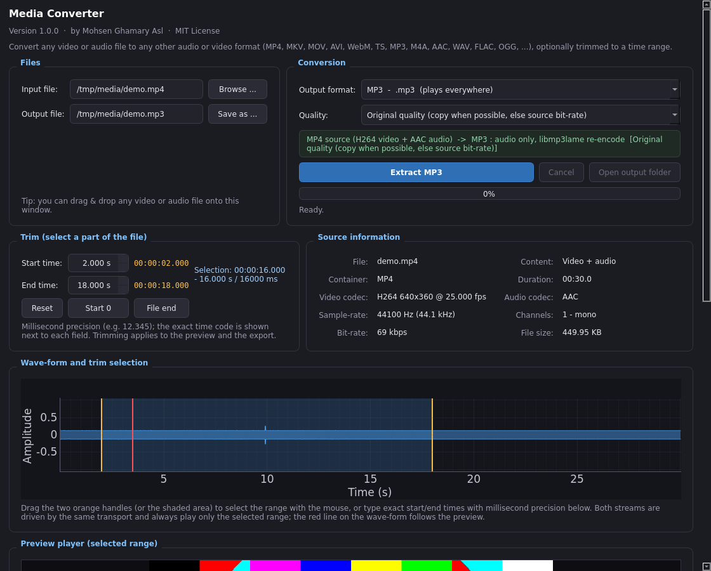

# Media Converter

**A desktop app (PyQt5 + pyqtgraph) that converts any video or audio file into any other audio or video format - with a live in-app player and millisecond-accurate trimming.**

Version **1.0.0** - Author **Mohsen Ghamary Asl** - License **MIT**


**What it does**

* **video -> audio** - extract / re-encode the sound track (MP3, M4A/AAC, AAC, Opus, OGG, FLAC, WAV, AIFF, WMA, AC-3)
* **audio -> audio** - convert between all of those formats
* **video -> video** - remux or re-encode into MP4, MKV, WebM, MOV, AVI, MPG, FLV, WMV, TS

The GUI is PyQt5, the wave-form preview is pyqtgraph, and all decoding/encoding
is done by **FFmpeg** (the only reliable way to handle every container/codec).



## Quick start

```bash
git clone https://github.com/MohsenGhamaryAsl/Media-Converter.git
cd Media-Converter
python -m venv .venv && source .venv/bin/activate     # Windows: .venv\Scripts\activate
pip install -r requirements.txt
python Media_Converter.py
```

Repository: <https://github.com/MohsenGhamaryAsl/Media-Converter>

Needs Python 3.8+ and FFmpeg (see [section 2](#2-requirements) for the three
ways to provide it).

---

## 1. Feature overview

| | |
|---|---|
| Input | anything FFmpeg can demux: MP4, M4V, MOV, MKV, WebM, AVI, TS/M2TS, FLV, WMV, MPG, 3GP, OGV, VOB ... and MP3, M4A, AAC, WAV, FLAC, OGG, Opus, WMA, AIFF, AC3, AMR, APE, MKA, WavPack ... (drag & drop accepts anything) |
| Audio outputs | MP3, M4A/AAC, AAC (ADTS), Opus, OGG Vorbis, FLAC, WAV, AIFF, WMA, AC-3 |
| Video outputs | MP4 (H.264+AAC), MKV (H.264+AAC), WebM (VP9+Opus), MOV, AVI (MPEG-4+MP3), MPG (MPEG-2+MP2), FLV, WMV, TS |
| Smart format list | unusable targets are greyed out **with the reason**: missing encoder in your FFmpeg build, **source already in that format**, **audio-only source for a video target** (and vice versa) |
| Conversion plan | one-line preview before starting, e.g. `MP4 source (H264 video + AAC audio) -> MKV : H264 copy + aac audio` |
| Presets | audio: `original`, `best`, `vbr2`, `320/256/192/128 kbps`; video: `original` (stream copy when possible), `best`, `high`, `balanced`, `small` |
| Lossless | FLAC / WAV / AIFF (bit-perfect stream copy when the source already matches) |
| Trim | mouse selection on the wave-form **or** millisecond-precise start/end fields; works for audio and video |
| **Preview player** | **one unified player** that drives the embedded video *and* the audio together, so both start/stop at the same moment and follow the same trim range: Play / Pause / Stop / Loop / Volume / `HH:MM:SS.mmm`, moving red play-head on the wave-form, Space = play/pause |
| Video rendering | FFmpeg decodes the range straight into a fixed-size canvas widget (`QPainter`, letterboxed, ~25 fps, latest-frame-only so a slow machine just drops frames instead of lagging). The canvas has a constant size hint, so the layout never "grows" while playing |
| Audio engines | tried automatically: **1) `ffplay`** (ships with FFmpeg) -> **2) QtMultimedia** -> **3) `winsound`** (Windows) -> **4) system media player** (renders the range to a temp file). The active engine is shown under the transport (`audio engine: ffplay`) and every failure is explained in the log |
| Log tools | **Save log ...** (Ctrl+S) writes the log to a text file, **Clear log** (Ctrl+L) empties it |
| Feedback | live percentage, processed seconds, speed, cancel button, colour-coded log |
| Layout | compact two-column arrangement (Files + Conversion on the first row, Trim + Source information on the second), a slim wave-form and no horizontal scrolling; the whole window still scrolls vertically |
| CLI | `python Media_Converter.py --nogui in.mkv -f mp4v -o out.mp4 --start 5.25 --end 30` |

---

## 2. Requirements

### Python packages

```bash
python -m venv .venv
.venv\Scripts\activate      # Windows   (macOS/Linux: source .venv/bin/activate)
pip install -r requirements.txt
```

| Package | Why it is needed |
|---|---|
| `PyQt5` | the GUI |
| `pyqtgraph` + `numpy` | the interactive wave-form and the trim selection |
| `imageio-ffmpeg` | **bundled FFmpeg binary** - lets the app work even when FFmpeg is not installed system-wide |

### FFmpeg - pick the option that suits you

The conversion itself is done by FFmpeg. You have **three options**; the app
tries them in this order and always tells you in the log which one it used
(`FFmpeg  : /usr/bin/ffmpeg`):

| Option | How to do it | Pros | Cons |
|---|---|---|---|
| **1. System FFmpeg** *(recommended)* | Windows: [gyan.dev builds](https://www.gyan.dev/ffmpeg/builds/), unzip and add the `bin` folder to `PATH` - macOS: `brew install ffmpeg` - Linux: `sudo apt install ffmpeg` | full build: `ffmpeg` + **`ffprobe`** + **`ffplay`**; fastest, no download at runtime | manual one-time install |
| **2. `pip install imageio-ffmpeg`** *(already in `requirements.txt`)* | nothing else - it is installed with the other packages | zero setup; the binary is downloaded once when the package is installed and cached inside the package folder | **no `ffprobe`** (the app automatically falls back to its own `ffmpeg -i` parser) and **no `ffplay`**, so the audio preview uses QtMultimedia / the system player instead of `ffplay` |
| **3. Point the app at any existing binary** | set the environment variable `IMAGEIO_FFMPEG_EXE=/full/path/to/ffmpeg` (honoured by `imageio-ffmpeg`) or simply put `ffmpeg` on `PATH` | useful for a portable/offline copy, or a custom build with extra codecs | you maintain the path |

Notes

* Check what you have: `ffmpeg -version`, `ffprobe -version`, `ffplay -version`.
* `ffprobe` only affects the *accuracy* of the "Source information" panel - without it a slightly simpler parser is used and everything still works.
* `ffplay` only affects the audio preview engine: without it the app automatically uses **QtMultimedia**, then `winsound` (Windows), then the system media player. Video preview and every conversion always work.
* If no FFmpeg is found at all, the app says so in the log and in a dialog instead of producing a broken file.

---

## 3. Running it in VS Code

1. `File > Open Folder...` -> this folder.
2. `Ctrl+Shift+P > Python: Select Interpreter > .venv`.
3. `pip install -r requirements.txt`
4. **F5** (a launch configuration is included) or `python Media_Converter.py`.

### Using the window

1. **Browse...** (or drag & drop) any file - the app probes it and draws the
   audio wave-form (a silent video simply shows "no audio stream").
2. Pick the **Output format**. The list is split into *Audio output* and
   *Video output*; blocked entries are greyed out with an explanation tooltip,
   so an audio file can never be "converted" to a video and a file is never
   converted into the very same format.
3. Check the green **conversion plan** line - it tells you exactly what will be
   copied and what will be re-encoded.
4. Choose the **Quality** preset (video files get video-oriented presets).
5. *(Optional)* **Trim**: drag the orange handles on the wave-form, or type
   `Start` / `End` in seconds with millisecond precision (`12.345`). Shortcuts:
   `Reset (whole file)`, `Start = 0`, `End = file end`.
6. *(Optional)* **Check the range before converting** - the **Preview player**
   box has a single transport for both streams. The buttons follow a strict
   state machine: *idle* -> only **Play**; *playing* -> only **Pause**/**Stop**;
   *paused* -> **Resume** + **Stop**; *external* -> only **Stop**.
   Changing the trim handles **while playing** is applied live: extending the
   end keeps playing, moving an edge behind the play-head restarts (or stops)
   and only the audio engine is restarted, so the picture never flickers:
   * **Play** - starts the embedded video *and* the audio engine at the same
     moment, only for the selected range (Pause, Stop, Loop, Volume,
     `HH:MM:SS.mmm`). Space toggles play/pause; the red line on the wave-form
     follows the position.
   * For audio-only files the canvas is hidden automatically; for silent videos
     the transport drives the video alone.
   * The status line under the transport shows the active audio engine
     (`audio engine: ffplay` / `QtMultimedia` / `winsound` / `system media
     player`) and the streams being played. **Open in system player** is the
     manual fallback (temporary file, deleted when the app closes).
7. Press **Extract MP3 / Convert to MKV / ...**. Progress, speed and log lines are
   live; **Cancel** aborts and deletes the partial file.
8. The **Log** box has **Save log ...** (Ctrl+S) and **Clear log** (Ctrl+L) buttons.

### Command line

```bash
# video -> audio
python Media_Converter.py --nogui movie.mkv -f mp3 -o "D:/out/movie.mp3"
# audio -> audio (lossless)
python Media_Converter.py --nogui song.wav -f flac -o "D:/out/song.flac"
# video -> video (remux, no re-encoding when possible)
python Media_Converter.py --nogui clip.mp4 -f mkv -o "D:/out/clip.mkv"
# video -> video, trimmed from 5.250 s to 30 s
python Media_Converter.py --nogui clip.mp4 -f mp4v -o out.mp4 --start 5.250 --end 30
```

`-f/--format` accepts:
`mp3, m4a, aac, opus, ogg, flac, wav, aiff, wma, ac3, mp4v, mkv, webm, mov, avi, mpg, flvv, wmv, tsv`
(default: taken from the `-o` extension, otherwise `mp3`).
`-p/--preset`: `original, best, vbr2, 320, 256, 192, 128`.
`--start` / `--end` are seconds (`--end 0` = end of file).

---

## 4. What gets copied, what gets re-encoded

| Source | Target | "original" preset behaviour |
|---|---|---|
| MP4 (H.264 + AAC) | MKV | **both streams copied** - remux only, instant, zero loss |
| MP4 (H.264 + AAC) | WebM | video re-encoded to VP9, audio to Opus (WebM cannot hold H.264/AAC) |
| MP4 (AAC) | MP3 | audio re-encoded with LAME at the source bit-rate (MP3 is lossy) |
| MP4 (AAC) | FLAC/WAV | decoded and stored losslessly (bigger, mathematically exact) |
| MP3 | MP3 | not offered - the source is already MP3 (choose another format) |
| WAV | FLAC | lossless re-encode (no quality loss) |
| FLAC | FLAC | not offered - same format; a trimmed FLAC is re-encoded losslessly |

Audio limits are handled automatically: MP3 -> <=48 kHz / <=2 channels,
Opus -> 48 kHz, WMA -> <=48 kHz / 2 channels, etc., always with a log notice.

---

## 5. Project layout

```
Media-Converter/
|-- Media_Converter.py     # the whole application (GUI + conversion engine + CLI)
|-- requirements.txt
|-- README.md
|-- LICENSE                # MIT
|-- screenshot.png
`-- .vscode/
    `-- launch.json        # F5 launcher for VS Code (GUI and CLI examples)
```

| Section in `Media_Converter.py` | Purpose |
|---|---|
| `OutputFormat`, `OUTPUT_FORMATS` | table of all audio + video targets (codecs, container limits, quality mapping) |
| `format_availability` | decides whether a target is usable for a given source and explains why not |
| `MediaInfo`, `probe_media` | reads audio **and** video stream properties (`ffprobe`, with an `ffmpeg -i` fallback) |
| `analyse_waveform` | decodes 4 kHz mono audio with NumPy and builds the plot envelope |
| `build_codec_arguments` | builds `-c:v` / `-c:a` arguments for any preset + target |
| `extract_audio` | runs FFmpeg with `-progress`, handles trim, cancellation and errors |
| `AnalyseWorker`, `ExtractWorker` | `QThread`s so the UI never freezes |
| `MainWindow` | the GUI (inside a `QScrollArea`), format filtering, drag & drop, dialogs |
| `VideoFrameWorker` | decodes a trimmed video range with `ffmpeg -re ... -f rawvideo` and emits `QImage` frames |
| `_start_preview`, `_pause_preview`, `_stop_preview` | the unified transport (starts/stops video engine + audio engine together) |
| `_update_playback_controls` | the transport state machine (`idle`/`playing`/`paused`/`external`) that enables exactly the buttons that make sense |
| `_sync_preview_with_trim`, `_apply_trim_to_preview` | live reaction to trim edits while playing (debounced audio restart, no video flicker) |
| `_try_audio_backends`, `_play_with_ffplay/_qt/_winsound/system` | automatic audio-engine escalation with verified start-up |
| `_on_preview_tick`, `_current_position` | clock-driven position, red play-head, loop and auto-stop at the end of the range |
| `VideoFrameWorker`, `_pull_video_frame` | frame-accurate embedded video (latest-frame-only hand-off, no queue growth) |
| `_preview_in_system_player` | renders the selection to a temporary MP3 with `ExtractWorker` and opens it with the OS player |
| `_save_log`, `_clear_log` | log file export / clearing |
| `run_cli` | head-less mode using the same engine |

---

## 6. Troubleshooting

| Symptom | Fix |
|---|---|
| *"FFmpeg was not found"* | install FFmpeg and add it to `PATH`, or `pip install imageio-ffmpeg` |
| A format is greyed out | hover it - the tooltip says why (missing encoder / same format / no video stream) |
| *"The file contains neither an audio nor a video stream"* | the file is empty or unsupported |
| Video export is slow | video re-encoding is CPU heavy; use `original` (stream copy) or the `small` preset |
| No window appears on Linux | `sudo apt install libxcb-xinerama0 libxkbcommon-x11-0` |
| Play plays no sound | read the `audio engine:` line and the log: the app falls back ffplay -> QtMultimedia -> winsound -> system player automatically and explains each failure. Make sure your FFmpeg build ships `ffplay` (gyan.dev and BtbN builds do) |
| The video area keeps its size while playing | the canvas has a constant size hint and is painted with `QPainter` instead of resizing a `QLabel` |
| `ffprobe`/`ffplay` missing in the log | you are using the `imageio-ffmpeg` binary; install a full FFmpeg build to get them (see section 2) |
| A codec cannot be previewed (e.g. AC-3 in an MKV) | use **Preview in system player** - it converts the selection to MP3 first |

---

## 7. Author

**Mohsen Ghamary Asl**

Bugs, ideas and pull requests are welcome - please open an
[issue](https://github.com/MohsenGhamaryAsl/Media-Converter/issues) or a pull request.

## 8. License

MIT (c) 2026 Mohsen Ghamary Asl - see [LICENSE](LICENSE). Use, modify and
redistribute freely; a link back to this repository is appreciated.

---

## 9. Publishing this folder on GitHub

The repository is <https://github.com/MohsenGhamaryAsl/Media-Converter>.
For a new clone of this folder (first push):

```bash
cd Media-Converter
git init
git add .
git commit -m "Media Converter 1.0.0"
git branch -M main
git remote add origin https://github.com/MohsenGhamaryAsl/Media-Converter.git
git push -u origin main
```

If the repository already exists and contains a README, pull it first
(`git pull origin main --allow-unrelated-histories`) or initialise with
`git remote add origin ...` only. Set `git config user.name` / `user.email`
once if Git asks who you are.

Suggested repository description:
*"PyQt5 + FFmpeg converter for any audio/video format, with an in-app player,
millisecond-accurate trimming and lossless remuxing."*

Suggested topics:
`python` `pyqt5` `pyqtgraph` `ffmpeg` `media-converter` `audio-converter`
`video-converter` `mp4-to-mp3` `desktop-app` `video-editing`
